# Mô hình dữ liệu tenant

Sinh từ `prisma/schema.prisma` bằng `pnpm --filter @solar/db db:erd`.

Khóa ngoại giữa bảng tenant luôn ghép `(tenantId, xxxId) → (tenantId, id)`.
`Outbox` và `AuditLog` cho phép `tenantId = null` cho tác vụ nền tảng.

```mermaid
erDiagram
  Plan {
    String id PK
    String name
    String_array features
    Json limits
    DateTime syncedAt
    DateTime createdAt
    DateTime updatedAt
  }
  Tenant {
    String id PK
    String name
    String slug UK
    TenantStatus status
    String planId
    DateTime planExpiresAt
    String_array addons
    String customerId
    Json featureOverrides
    Json limitOverrides
    Json permissionPolicy
    StorageDriver storageDriver
    DateTime createdAt
    DateTime updatedAt
  }
  Customer {
    String id PK
    String name
    String taxCode
    String contactName
    String contactEmail
    String contactPhone
    String address
    String note
    CustomerStatus status
    DateTime createdAt
    DateTime updatedAt
  }
  PlatformAdmin {
    String id PK
    String email UK
    String name
    String passwordHash
    String totpSecret
    String_array totpBackupCodes
    Int totpLastStep
    AccountStatus status
    DateTime lastLoginAt
    DateTime createdAt
    DateTime updatedAt
  }
  PlatformSession {
    String id PK
    String platformAdminId
    String tokenHash UK
    DateTime expiresAt
    DateTime lastSeenAt
    String ip
    String userAgent
    DateTime createdAt
  }
  GhostGrant {
    String id PK
    String platformAdminId
    String targetTenantId
    String reason
    String tokenHash UK
    DateTime expiresAt
    DateTime sessionExpiresAt
    DateTime usedAt
    DateTime revokedAt
    DateTime createdAt
  }
  PlatformSetting {
    String key PK
    Json value
    String updatedById
    DateTime updatedAt
  }
  SiteUser {
    String id PK
    String tenantId
    String email
    String phone
    String username
    String name
    String passwordHash
    SiteRole role
    SiteUserStatus status
    SiteUserSource source
    DateTime emailVerifiedAt
    String contactPhone
    Boolean mustChangePassword
    DateTime tempPasswordExpiresAt
    String totpSecret
    String_array totpBackupCodes
    Int totpLastStep
    DateTime lastLoginAt
    Int failedLogins
    DateTime lockedUntil
    DateTime createdAt
    DateTime updatedAt
  }
  SiteSession {
    String id PK
    String tenantId
    String siteUserId
    SessionKind kind
    SessionAudience audience
    String ghostGrantId
    String tokenHash UK
    DateTime expiresAt
    DateTime lastSeenAt
    String ip
    String userAgent
    DateTime createdAt
  }
  SiteToken {
    String id PK
    String tenantId
    String siteUserId
    SiteTokenPurpose purpose
    String tokenHash UK
    DateTime expiresAt
    DateTime usedAt
    DateTime createdAt
  }
  PreviewToken {
    String id PK
    String tenantId
    String siteId
    String tokenHash UK
    DateTime expiresAt
    DateTime usedAt
    DateTime createdAt
  }
  Domain {
    String id PK
    String tenantId
    String siteId
    String hostname UK
    Boolean isPrimary
    DomainStatus status
    String verificationToken
    DateTime verifiedAt
    SslProvider sslProvider
    String cfHostnameId
    DateTime createdAt
    DateTime updatedAt
  }
  Site {
    String id PK
    String tenantId
    String name
    String themeId
    String presetId
    Json themeOverrides
    String_array pageTypes
    String_array locales
    String defaultLocale
    Json profile
    Json widgets
    Json seo
    DateTime createdAt
    DateTime updatedAt
  }
  Page {
    String id PK
    String tenantId
    String siteId
    String slug
    PageKind kind
    Json title
    Json sections
    Json draftSections
    Int revision
    DateTime publishedAt
    DateTime createdAt
    DateTime updatedAt
  }
  PageVersion {
    String id PK
    String tenantId
    String pageId
    Int revision
    Json snapshot
    String publishedBySiteUserId
    String publishedByPlatformAdminId
    DateTime createdAt
  }
  SectionContent {
    String id PK
    String tenantId
    String siteId
    String pageId
    String sectionId
    String type
    Int schemaVersion
    Json data
    Json draftData
    DateTime removedAt
    Int revision
    DateTime createdAt
    DateTime updatedAt
  }
  Product {
    String id PK
    String tenantId
    String slug
    ContentStatus status
    Int order
    Json title
    Json data
    DateTime publishedAt
    String categoryId
    String brandId
    Int price
    Int salePrice
    Boolean featured
    String_array segments
    DateTime createdAt
    DateTime updatedAt
  }
  ProductCategory {
    String id PK
    String tenantId
    String slug
    ContentStatus status
    Int order
    Json title
    Json data
    DateTime publishedAt
    String parentId
    DateTime createdAt
    DateTime updatedAt
  }
  Project {
    String id PK
    String tenantId
    String slug
    ContentStatus status
    Int order
    Json title
    Json data
    DateTime publishedAt
    String segment
    Float kwp
    Boolean featured
    String coverMediaId
    DateTime createdAt
    DateTime updatedAt
  }
  Story {
    String id PK
    String tenantId
    String slug
    ContentStatus status
    Int order
    Json title
    Json data
    DateTime publishedAt
    String segment
    String kind
    String posterMediaId
    DateTime createdAt
    DateTime updatedAt
  }
  Post {
    String id PK
    String tenantId
    String slug
    ContentStatus status
    Int order
    Json title
    Json data
    DateTime publishedAt
    String segment
    String coverMediaId
    String_array tags
    DateTime createdAt
    DateTime updatedAt
  }
  Faq {
    String id PK
    String tenantId
    String slug
    ContentStatus status
    Int order
    Json title
    Json data
    DateTime publishedAt
    String group
    DateTime createdAt
    DateTime updatedAt
  }
  Testimonial {
    String id PK
    String tenantId
    String slug
    ContentStatus status
    Int order
    Json title
    Json data
    DateTime publishedAt
    String segment
    Float rating
    DateTime createdAt
    DateTime updatedAt
  }
  Branch {
    String id PK
    String tenantId
    String slug
    ContentStatus status
    Int order
    Json title
    Json data
    DateTime publishedAt
    Boolean isPrimary
    DateTime createdAt
    DateTime updatedAt
  }
  Certificate {
    String id PK
    String tenantId
    String slug
    ContentStatus status
    Int order
    Json title
    Json data
    DateTime publishedAt
    DateTime createdAt
    DateTime updatedAt
  }
  Brand {
    String id PK
    String tenantId
    String slug
    ContentStatus status
    Int order
    Json title
    Json data
    DateTime publishedAt
    String logoMediaId
    DateTime createdAt
    DateTime updatedAt
  }
  PressItem {
    String id PK
    String tenantId
    String slug
    ContentStatus status
    Int order
    Json title
    Json data
    DateTime publishedAt
    DateTime createdAt
    DateTime updatedAt
  }
  Service {
    String id PK
    String tenantId
    String slug
    ContentStatus status
    Int order
    Json title
    Json data
    DateTime publishedAt
    DateTime createdAt
    DateTime updatedAt
  }
  Media {
    String id PK
    String tenantId
    String key UK
    StorageDriver driver
    MediaVisibility visibility
    MediaStatus status
    String mime
    Int size
    Int width
    Int height
    Json variants
    Json alt
    String name
    Json focal
    DateTime orphanedAt
    DateTime createdAt
  }
  Lead {
    String id PK
    String tenantId
    String siteId
    String source
    String segment
    String name
    String phone
    String email
    String message
    Json data
    LeadStatus status
    String note
    String assigneeId
    String branchId
    DateTime createdAt
    DateTime updatedAt
  }
  Outbox {
    String id PK
    String tenantId
    String topic
    Json payload
    String idempotencyKey UK
    OutboxStatus status
    Int attempts
    DateTime runAt
    String lastError
    DateTime processedAt
    DateTime createdAt
  }
  LeadIntegration {
    String id PK
    String tenantId
    IntegrationKind kind
    String name
    Boolean enabled
    String configEncrypted
    DateTime createdAt
    DateTime updatedAt
  }
  AuditLog {
    String id PK
    String tenantId
    AuditActorType actorType
    String actorId
    String ghostGrantId
    String action
    String entity
    String entityId
    Json data
    DateTime createdAt
  }
  Plan ||--o{ Tenant : "planId"
  Customer |o--o{ Tenant : "customerId"
  PlatformAdmin ||--o{ PlatformSession : "platformAdminId"
  PlatformAdmin ||--o{ GhostGrant : "platformAdminId"
  Tenant ||--o{ GhostGrant : "targetTenantId"
  PlatformAdmin |o--o{ PlatformSetting : "updatedById"
  Tenant ||--o{ SiteUser : "tenantId"
  SiteUser |o--o{ SiteSession : "tenantId, siteUserId"
  GhostGrant |o--o{ SiteSession : "tenantId, ghostGrantId"
  Tenant ||--o{ SiteSession : "tenantId"
  SiteUser ||--o{ SiteToken : "tenantId, siteUserId"
  Tenant ||--o{ SiteToken : "tenantId"
  Tenant ||--o{ PreviewToken : "tenantId"
  Site ||--o{ PreviewToken : "tenantId, siteId"
  Site ||--o{ Domain : "tenantId, siteId"
  Tenant ||--o{ Domain : "tenantId"
  Tenant ||--o{ Site : "tenantId"
  Site ||--o{ Page : "tenantId, siteId"
  Tenant ||--o{ Page : "tenantId"
  Page ||--o{ PageVersion : "tenantId, pageId"
  SiteUser |o--o{ PageVersion : "tenantId, publishedBySiteUserId"
  PlatformAdmin |o--o{ PageVersion : "publishedByPlatformAdminId"
  Tenant ||--o{ PageVersion : "tenantId"
  Site ||--o{ SectionContent : "tenantId, siteId"
  Page ||--o{ SectionContent : "tenantId, pageId"
  Tenant ||--o{ SectionContent : "tenantId"
  ProductCategory |o--o{ Product : "tenantId, categoryId"
  Brand |o--o{ Product : "tenantId, brandId"
  Tenant ||--o{ Product : "tenantId"
  ProductCategory |o--o{ ProductCategory : "tenantId, parentId"
  Tenant ||--o{ ProductCategory : "tenantId"
  Media |o--o{ Project : "tenantId, coverMediaId"
  Tenant ||--o{ Project : "tenantId"
  Media |o--o{ Story : "tenantId, posterMediaId"
  Tenant ||--o{ Story : "tenantId"
  Media |o--o{ Post : "tenantId, coverMediaId"
  Tenant ||--o{ Post : "tenantId"
  Tenant ||--o{ Faq : "tenantId"
  Tenant ||--o{ Testimonial : "tenantId"
  Tenant ||--o{ Branch : "tenantId"
  Tenant ||--o{ Certificate : "tenantId"
  Media |o--o{ Brand : "tenantId, logoMediaId"
  Tenant ||--o{ Brand : "tenantId"
  Tenant ||--o{ PressItem : "tenantId"
  Tenant ||--o{ Service : "tenantId"
  Tenant ||--o{ Media : "tenantId"
  SiteUser |o--o{ Lead : "tenantId, assigneeId"
  Branch |o--o{ Lead : "tenantId, branchId"
  Site |o--o{ Lead : "tenantId, siteId"
  Tenant ||--o{ Lead : "tenantId"
  Tenant |o--o{ Outbox : "tenantId"
  Tenant ||--o{ LeadIntegration : "tenantId"
  Tenant |o--o{ AuditLog : "tenantId"
```

